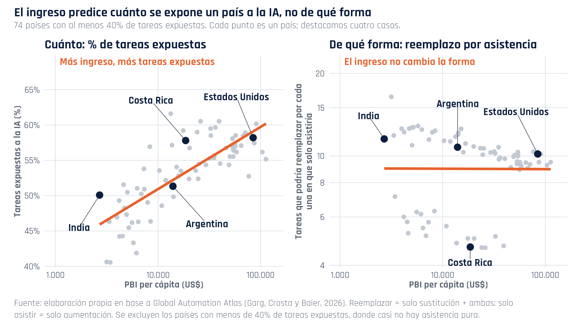

# Atlas de automatización con IA

**¿Qué explica el ingreso de un país sobre cuánto, y de qué forma, lo alcanza la inteligencia artificial?**

Trabajo final · Ciencia de Datos para Economía y Negocios · FCE-UBA · 2.º cuatrimestre de 2026
Docente: Nicolás Sidicaro · Grupo 16



## 1. Integrantes

- Lautaro González ([@Lauti91](https://github.com/Lauti91))
- Esteban Quirino
- Valery Vanegas ([@valeryvanegas-uba](https://github.com/valeryvanegas-uba))

## 2. Objetivo e hipótesis

Estudiar cómo se expone el trabajo de 124 países a la inteligencia artificial según el Global Automation Atlas, y si el ingreso del país ordena esa exposición.

| Hipótesis | Enunciado | Resultado |
|:---|:---|:---|
| **H1 · Nivel** | A mayor PBI per cápita, mayor porcentaje de tareas expuestas a la IA. | **Se confirma.** El ingreso explica el 61% de las diferencias (R² = 0,61; n = 74). |
| **H2 · Forma** | El ingreso no predice *cómo* llega la IA: cuántas tareas reemplazaría por cada una que solo asistiría. | **Se sostiene con matices.** R² < 0,001; con los 122 países sube a 0,24, pero ahí el cociente es inestable. |

**Alcance.** El trabajo es descriptivo, no causal. La exposición la estima un modelo de lenguaje por tarea, condicionado al contexto de cada país: se describe cómo juzga el modelo, no efectos reales sobre el empleo.

## 3. Base de datos

| | |
|:---|:---|
| **Fuente** | Global Automation Atlas (Garg, Crosta y Baier, 2026) · [automationatlas.org](https://automationatlas.org) · [código y datos](https://github.com/prashgarg/global-automation-atlas) |
| **Unidad de observación** | País × ocupación O\*NET (panel principal) y país (base auxiliar) |
| **Tamaño** | 114.452 filas = 124 países × 923 ocupaciones · 12 variables · sin faltantes ni duplicados |
| **Período** | Un solo corte: estimaciones para 2026 |
| **Limitaciones** | No es automatización observada. Cada ocupación pesa igual (no se pondera por empleo). La escala (0 a 3) tiene piso y techo. |

## 4. Análisis

1. **Limpieza** (faltantes y atípicos con la regla de Tukey). El panel no tiene faltantes. Los 251 atípicos dentro de cada grupo ocupacional (0,22%) y las 42 observaciones del techo de la escala son valores válidos y se mantienen. Etiopía y Venezuela, sin clasificación de ingreso, quedan fuera de los análisis con ingreso: 122 países (74 en la regresión).
2. **ANOVA de dos factores** *(unidad 2)*. País y ocupación explican el 93% de la varianza (η² = 0,44 y 0,49): un país sube o baja todas sus ocupaciones en bloque, así que tiene sentido agrupar países. Welch, Fligner-Killeen y Kruskal-Wallis no cambian la conclusión.
3. **HCPC: ACP + Ward + k-means** *(unidad 3)*. Tres tramos de 23 / 33 / 68 países. Los límites son difusos y el agrupamiento responde sobre todo al nivel de exposición (ARI = 0,87 con solo la exposición media; 0,64 entre k = 3 y k = 4).
4. **Kruskal-Wallis y χ²** *(unidad 2)*. Los tramos siguen al ingreso: ε² = 0,72 y V de Cramér = 0,79.
5. **Regresión lineal con errores HC3** *(unidad 2)*. % de tareas expuestas ~ log(PBI): R² = 0,61 (pendiente 0,038; EE 0,004). Razón reemplazo/asistencia ~ log(PBI): R² < 0,001 (p = 0,96).

## 5. Estructura del repositorio

```text
atlas_ia_grupo16/
├── raw/                  Datos crudos, sin modificar
│   └── country_occupation_panel.parquet   panel país × ocupación (114.452 filas)
├── auxiliar/             Bases complementarias
│   ├── country_map_panel.csv              países: ingreso, PBI, población
│   ├── grupos_ocupacionales.csv           nombres de los 22 grupos SOC
│   ├── nombres_paises_es.csv              nombres de países en español
│   └── fuentes/                           fuente Rajdhani y su licencia (OFL)
├── input/                Datos procesados (los generan los scripts)
│   ├── panel_analisis.csv
│   ├── paises_analisis.csv
│   └── paises_tramos.csv
├── output/
│   ├── tablas/           18 tablas de resultados (CSV)
│   └── graficos/         15 gráficos (PNG, 300 dpi)
├── script/               Scripts numerados en orden de ejecución (00 a 08)
├── utils/                Funciones propias (una por archivo) y configuración de gráficos
├── atlas_ia_grupo16.Rproj
└── README.md
```

`raw/` tiene el panel en el formato en que lo publica el Atlas (parquet), sin modificar. Se lee con el paquete `arrow`.

## 6. Cómo reproducir

1. **Abrir el proyecto.** Abrir `atlas_ia_grupo16.Rproj` en RStudio (R 4.3 o posterior). Las rutas son relativas, con `here()`.
2. **Correr todo.**

   ```r
   source("script/00_correr_todo.R")
   ```

   El script 00 instala los paquetes que falten y corre los scripts 01 a 08 en orden. Cada script también corre solo, una vez que existen los archivos de `input/`.

Paquetes: `here`, `arrow`, `tidyverse`, `FactoMineR`, `ggrepel`, `cluster`, `patchwork`, `scales`, `sandwich`, `lmtest`, `ragg`, `systemfonts`.

**Notas**

- **FactoMineR.** La partición en tres tramos (23 / 33 / 68) se verificó con las versiones 2.9 y 2.18. El script 04 usa `pca_exacta()` (SVD exacta) para que el ACP no dependa de la versión. El corte automático de FactoMineR sí cambia (3 grupos con la 2.9, 9 con la 2.18): por eso k se fija en 3.
- **Fuente.** Los gráficos usan [Rajdhani](https://fonts.google.com/specimen/Rajdhani). Si no está instalada, se carga desde `auxiliar/fuentes/`.

## 7. Scripts

| # | Script | Qué hace | Guarda |
|:---:|:---|:---|:---|
| 00 | `00_correr_todo.R` | Instala paquetes faltantes y corre 01 a 08 | — |
| 01 | `01_limpieza_faltantes_outliers.R` | Faltantes, atípicos, limpieza, descriptivas antes y después | `input/panel_analisis.csv`, `input/paises_analisis.csv` · `disp.png` · 4 tablas |
| 02 | `02_descriptivas.R` | Histograma, exposición por grupo, correlograma (Pearson y Spearman) | `hist.png`, `barras.png`, `corr.png` · 3 tablas |
| 03 | `03_anova_pais_ocupacion.R` | **Método 1.** ANOVA (η²) y supuestos | `eta2.png`, `qq.png` · 2 tablas |
| 04 | `04_hcpc_tramos_paises.R` | **Método 2.** ACP + HCPC (k = 3), validación, sensibilidad de k, HCPC por composición | `input/paises_tramos.csv` · `kdendro.png`, `mapa.png`, `fronteras.png`, `robust.png`, `compos.png` · 3 tablas |
| 05 | `05_kruskal_chi2_tramos_ingreso.R` | **Método 3.** Kruskal-Wallis y χ² de tramos contra ingreso | `ingreso.png` · 1 tabla |
| 06 | `06_grafico_exploratorio_nivel_y_tipo.R` | Gráfico exploratorio | `expl.png` · 1 tabla |
| 07 | `07_regresion_y_grafico_comunicativo.R` | **Método 4.** Regresión HC3, supuestos, sensibilidad y gráfico comunicativo | `comu.png` · 2 tablas |
| 08 | `08_brecha_por_grupo_ocupacional.R` | Brecha entre tramos por grupo ocupacional y test de permutación | `soc.png` · 2 tablas |

Cada script indica en su encabezado qué archivos lee y cuáles guarda. Todos los gráficos llevan título, subtítulo, ejes, leyendas, fuente y notas dentro de la imagen; los exporta `guardar_png()` a 300 dpi.

**Funciones propias (`utils/`):** `coma`, `nombre_es`, `ari`, `ordenar_clusters`, `pca_exacta`, `cargar_nombres_soc`, `leer_paises_con_tramos`, `unir`, `theme_slide`, `theme_panel`, `guardar_png`. `configuracion_graficos.R` define la paleta, la fuente y los textos fijos.

## 8. Conclusiones

- El ingreso ordena **cuánto** se expone un país a la IA (R² = 0,61), pero casi no explica **de qué forma** llega (R² < 0,001).
- Los tramos de países son cortes de un continuo, no grupos separados. Clasificar por composición de la exposición separa países de nivel parecido (ARI = 0,44 frente al nivel).
- Todo describe cómo el modelo de lenguaje juzga las tareas; no hay causalidad.
- **Próximos pasos:** sumar salarios (ILOSTAT, ISCO-08), ponderar por empleo, entender la bimodalidad del cociente y probar otros cortes y otro modelo de lenguaje.
