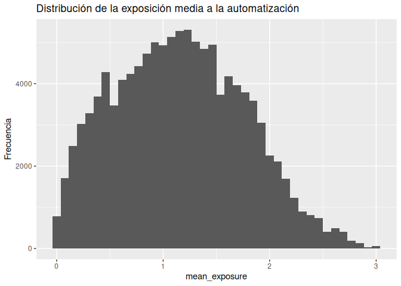
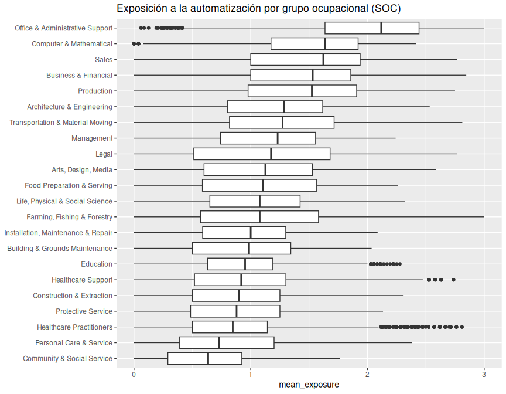
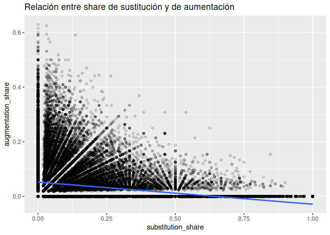

EDA - Global Automation Atlas (country x occupation)
================
Grupo CDD - FCE UBA
2026-09-11

## 0. Objetivo

Este script realiza el Análisis Exploratorio de Datos (EDA) de la base
`country_occupation_panel.parquet`, del proyecto Global Automation Atlas
(Garg, Crosta & Baier, 2026), como insumo para la Instancia 1 del TP.

``` r
library(arrow)
library(tidyverse)
library(janitor)
library(skimr)
```

## 1. Presentación de la base

``` r
occ <- read_parquet("../datos/country_occupation_panel.parquet")

dim(occ)
```

    ## [1] 114452     12

``` r
glimpse(occ)
```

    ## Rows: 114,452
    ## Columns: 12
    ## $ iso3               <chr> "AFG", "AFG", "AFG", "AFG", "AFG", "AFG", "AFG", "A…
    ## $ country_name       <chr> "Afghanistan", "Afghanistan", "Afghanistan", "Afgha…
    ## $ onet_soc_code      <chr> "11-1011.00", "11-1011.03", "11-1021.00", "11-1031.…
    ## $ occupation_title   <chr> "Chief Executives", "Chief Sustainability Officers"…
    ## $ task_count         <int> 42, 27, 28, 34, 39, 27, 19, 27, 23, 23, 12, 42, 27,…
    ## $ mean_exposure      <dbl> 0.1904762, 0.2592593, 0.2500000, 0.1176471, 0.35897…
    ## $ substitution_share <dbl> 0.00000000, 0.00000000, 0.00000000, 0.02941176, 0.0…
    ## $ augmentation_share <dbl> 0.02380952, 0.00000000, 0.00000000, 0.00000000, 0.0…
    ## $ sub_only_share     <dbl> 0.00000000, 0.00000000, 0.00000000, 0.02941176, 0.0…
    ## $ both_share         <dbl> 0.07142857, 0.07407407, 0.03571429, 0.02941176, 0.0…
    ## $ aug_only_share     <dbl> 0.02380952, 0.00000000, 0.00000000, 0.00000000, 0.0…
    ## $ neither_share      <dbl> 0.9047619, 0.9259259, 0.9642857, 0.9411765, 0.89743…

- **Fuente**: Global Automation Atlas (Garg, Crosta & Baier, 2026), repo
  `prashgarg/global-automation-atlas`.
- **Fenómeno / población**: exposición de ocupaciones (clasificación
  O\*NET-SOC) a la automatización (sustitución vs. aumentación de
  tareas), replicado para cada país.
- **Unidad de observación**: una ocupación O\*NET dentro de un país (par
  país x ocupación).
- **Observaciones**: 114452 filas.
- **Período**: snapshot (no tiene dimensión temporal).

## 2. Descripción de las variables

``` r
# Chequeo de valores nulos por columna
colSums(is.na(occ))
```

    ##               iso3       country_name      onet_soc_code   occupation_title 
    ##                  0                  0                  0                  0 
    ##         task_count      mean_exposure substitution_share augmentation_share 
    ##                  0                  0                  0                  0 
    ##     sub_only_share         both_share     aug_only_share      neither_share 
    ##                  0                  0                  0                  0

``` r
skim(occ)
```

|                                                  |        |
|:-------------------------------------------------|:-------|
| Name                                             | occ    |
| Number of rows                                   | 114452 |
| Number of columns                                | 12     |
| \_\_\_\_\_\_\_\_\_\_\_\_\_\_\_\_\_\_\_\_\_\_\_   |        |
| Column type frequency:                           |        |
| character                                        | 4      |
| numeric                                          | 8      |
| \_\_\_\_\_\_\_\_\_\_\_\_\_\_\_\_\_\_\_\_\_\_\_\_ |        |
| Group variables                                  | None   |

Data summary

**Variable type: character**

| skim_variable    | n_missing | complete_rate | min | max | empty | n_unique | whitespace |
|:-----------------|----------:|--------------:|----:|----:|------:|---------:|-----------:|
| iso3             |         0 |             1 |   3 |   3 |     0 |      124 |          0 |
| country_name     |         0 |             1 |   4 |  20 |     0 |      124 |          0 |
| onet_soc_code    |         0 |             1 |  10 |  10 |     0 |      923 |          0 |
| occupation_title |         0 |             1 |   6 | 105 |     0 |      923 |          0 |

**Variable type: numeric**

| skim_variable | n_missing | complete_rate | mean | sd | p0 | p25 | p50 | p75 | p100 | hist |
|:---|---:|---:|---:|---:|---:|---:|---:|---:|---:|:---|
| task_count | 0 | 1 | 25.84 | 8.50 | 5 | 19.00 | 25.00 | 32.00 | 54.00 | ▁▇▇▃▁ |
| mean_exposure | 0 | 1 | 1.16 | 0.61 | 0 | 0.69 | 1.14 | 1.60 | 3.00 | ▅▇▇▃▁ |
| substitution_share | 0 | 1 | 0.16 | 0.19 | 0 | 0.00 | 0.09 | 0.22 | 1.00 | ▇▂▁▁▁ |
| augmentation_share | 0 | 1 | 0.04 | 0.07 | 0 | 0.00 | 0.00 | 0.06 | 0.63 | ▇▁▁▁▁ |
| sub_only_share | 0 | 1 | 0.16 | 0.19 | 0 | 0.00 | 0.09 | 0.22 | 1.00 | ▇▂▁▁▁ |
| both_share | 0 | 1 | 0.22 | 0.18 | 0 | 0.08 | 0.20 | 0.33 | 1.00 | ▇▅▂▁▁ |
| aug_only_share | 0 | 1 | 0.04 | 0.07 | 0 | 0.00 | 0.00 | 0.06 | 0.63 | ▇▁▁▁▁ |
| neither_share | 0 | 1 | 0.58 | 0.27 | 0 | 0.36 | 0.60 | 0.81 | 1.00 | ▃▆▆▇▇ |

Se deriva el **grupo ocupacional SOC (2 dígitos)** a partir del código
O\*NET, para tener una variable categórica agregada y manejable (22
categorías en vez de 923 ocupaciones puntuales):

``` r
# Los primeros 2 dígitos del código O*NET-SOC (ej. "11-1011.00" -> "11")
# identifican el "grupo mayor" SOC 2018 (ej. 11 = Management, 51 = Production)
soc_labels <- tibble::tribble(
  ~soc_major_group, ~soc_label,
  "11", "Management",
  "13", "Business & Financial",
  "15", "Computer & Mathematical",
  "17", "Architecture & Engineering",
  "19", "Life, Physical & Social Science",
  "21", "Community & Social Service",
  "23", "Legal",
  "25", "Education",
  "27", "Arts, Design, Media",
  "29", "Healthcare Practitioners",
  "31", "Healthcare Support",
  "33", "Protective Service",
  "35", "Food Preparation & Serving",
  "37", "Building & Grounds Maintenance",
  "39", "Personal Care & Service",
  "41", "Sales",
  "43", "Office & Administrative Support",
  "45", "Farming, Fishing & Forestry",
  "47", "Construction & Extraction",
  "49", "Installation, Maintenance & Repair",
  "51", "Production",
  "53", "Transportation & Material Moving"
)

occ <- occ %>%
  mutate(soc_major_group = str_sub(onet_soc_code, 1, 2)) %>%
  left_join(soc_labels, by = "soc_major_group")

occ %>% count(soc_label, sort = TRUE)
```

    ## # A tibble: 22 × 2
    ##    soc_label                              n
    ##    <chr>                              <int>
    ##  1 Production                         13268
    ##  2 Healthcare Practitioners           11036
    ##  3 Education                           7688
    ##  4 Construction & Extraction           7564
    ##  5 Life, Physical & Social Science     7440
    ##  6 Architecture & Engineering          6944
    ##  7 Management                          6944
    ##  8 Transportation & Material Moving    6448
    ##  9 Office & Administrative Support     6324
    ## 10 Installation, Maintenance & Repair  6200
    ## # ℹ 12 more rows

## 3. Exploración de los datos

### 3.1 Estadísticas descriptivas generales

``` r
occ %>%
  summarise(across(
    c(mean_exposure, substitution_share, augmentation_share, task_count),
    list(media = mean, mediana = median, sd = sd, min = min, max = max),
    .names = "{.col}_{.fn}"
  )) %>%
  pivot_longer(everything())
```

    ## # A tibble: 20 × 2
    ##    name                         value
    ##    <chr>                        <dbl>
    ##  1 mean_exposure_media         1.16  
    ##  2 mean_exposure_mediana       1.14  
    ##  3 mean_exposure_sd            0.607 
    ##  4 mean_exposure_min           0     
    ##  5 mean_exposure_max           3     
    ##  6 substitution_share_media    0.156 
    ##  7 substitution_share_mediana  0.0909
    ##  8 substitution_share_sd       0.187 
    ##  9 substitution_share_min      0     
    ## 10 substitution_share_max      1     
    ## 11 augmentation_share_media    0.0396
    ## 12 augmentation_share_mediana  0     
    ## 13 augmentation_share_sd       0.0677
    ## 14 augmentation_share_min      0     
    ## 15 augmentation_share_max      0.630 
    ## 16 task_count_media           25.8   
    ## 17 task_count_mediana         25     
    ## 18 task_count_sd               8.50  
    ## 19 task_count_min              5     
    ## 20 task_count_max             54

### 3.2 Distribución de la exposición media

``` r
ggplot(occ, aes(x = mean_exposure)) +
  geom_histogram(bins = 40) +
  labs(
    title = "Distribución de la exposición media a la automatización",
    x = "mean_exposure", y = "Frecuencia"
  )
```

<!-- -->

### 3.3 Exposición por grupo ocupacional (SOC)

``` r
occ %>%
  mutate(soc_label = fct_reorder(soc_label, mean_exposure, .fun = median)) %>%
  ggplot(aes(x = mean_exposure, y = soc_label)) +
  geom_boxplot() +
  labs(
    title = "Exposición a la automatización por grupo ocupacional (SOC)",
    x = "mean_exposure", y = NULL
  )
```

<!-- -->

### 3.4 Sustitución vs. aumentación

``` r
ggplot(occ, aes(x = substitution_share, y = augmentation_share)) +
  geom_point(alpha = 0.15) +
  geom_smooth(method = "lm", se = FALSE) +
  labs(
    title = "Relación entre share de sustitución y de aumentación",
    x = "substitution_share", y = "augmentation_share"
  )
```

<!-- -->

``` r
cor(occ$substitution_share, occ$augmentation_share)
```

    ## [1] -0.2228927

### 3.5 Ocupaciones más y menos expuestas

``` r
occ %>%
  group_by(occupation_title) %>%
  summarise(mean_exposure = mean(mean_exposure), .groups = "drop") %>%
  slice_max(mean_exposure, n = 10)
```

    ## # A tibble: 10 × 2
    ##    occupation_title                                  mean_exposure
    ##    <chr>                                                     <dbl>
    ##  1 Bookkeeping, Accounting, and Auditing Clerks               2.54
    ##  2 Payroll and Timekeeping Clerks                             2.39
    ##  3 Word Processors and Typists                                2.37
    ##  4 Billing and Posting Clerks                                 2.34
    ##  5 Tellers                                                    2.34
    ##  6 Insurance Claims and Policy Processing Clerks              2.31
    ##  7 Order Clerks                                               2.31
    ##  8 Statistical Assistants                                     2.27
    ##  9 Medical Secretaries and Administrative Assistants          2.26
    ## 10 Travel Agents                                              2.25

``` r
occ %>%
  group_by(occupation_title) %>%
  summarise(mean_exposure = mean(mean_exposure), .groups = "drop") %>%
  slice_min(mean_exposure, n = 10)
```

    ## # A tibble: 10 × 2
    ##    occupation_title                mean_exposure
    ##    <chr>                                   <dbl>
    ##  1 Dancers                                0.0539
    ##  2 Clergy                                 0.116 
    ##  3 Embalmers                              0.185 
    ##  4 Actors                                 0.196 
    ##  5 Choreographers                         0.205 
    ##  6 Oral and Maxillofacial Surgeons        0.234 
    ##  7 Nannies                                0.264 
    ##  8 Athletes and Sports Competitors        0.281 
    ##  9 Musicians and Singers                  0.295 
    ## 10 Animal Trainers                        0.306

## 4. Primeros hallazgos

1.  La base **no tiene valores nulos** en ninguna de sus 12 columnas.
2.  La distribución de `mean_exposure` presenta **asimetría hacia la
    derecha** (media 1.16 \> mediana ~1.14, con máximo en 3), sugiriendo
    que la mayoría de las ocupaciones tiene exposición moderada, pero
    existe una cola de ocupaciones con exposición muy alta.
3.  Existe una **correlación negativa moderada (-0.22)** entre
    `substitution_share` y `augmentation_share`: las ocupaciones tienden
    a diferenciarse entre las que la IA principalmente *sustituye* y las
    que principalmente *aumenta*, más que combinar ambas por igual.
4.  Se observan **diferencias marcadas entre grupos SOC** en el nivel de
    exposición media (a completar con la lectura del boxplot una vez
    ejecutado).
5.  La base cubre 124 países y 923 ocupaciones O\*NET, lo que permite
    tanto comparaciones entre países como entre ocupaciones.

**Preguntas para las próximas etapas:**

- ¿Cómo se relaciona la exposición a la automatización con los
  **salarios** por ocupación? (requiere incorporar datos de ingresos de
  ILOSTAT).
- ¿La relación entre exposición y salario depende del **nivel de ingreso
  del país** (`income_level`, disponible en `country_map_panel.csv`)?
